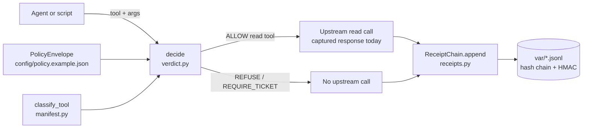
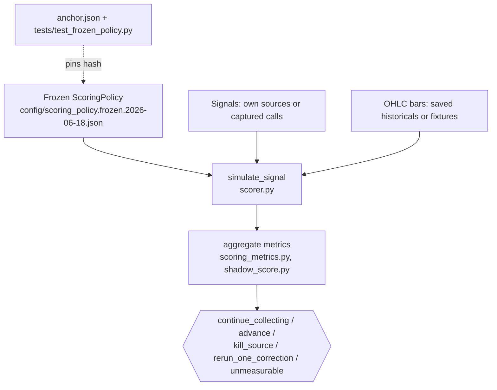
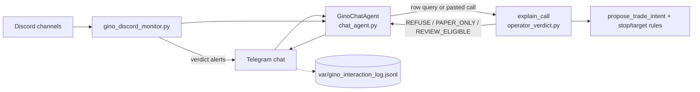

# Architecture

This repo has three layers that share one rule: the agent can propose, only
deterministic code decides, and every decision leaves a receipt.

1. **The gate** (`gino_gate/policy.py`, `manifest.py`, `verdict.py`, `receipts.py`,
   `server.py`, `live_read_client.py`): sits between an agent and a future Robinhood MCP
   client. It classifies tools, filters the manifest down to allowlisted read tools,
   computes a verdict from structured inputs, and appends a hash-chained, HMAC-signed
   receipt.
2. **The scorer and evidence pipeline** (`scoring_policy.py`, `scorer.py`,
   `scoring_metrics.py`, `shadow_score.py`, PlayBit modules): replays captured signals
   against price data under a frozen, hash-anchored scoring policy and turns the
   results into action verdicts.
3. **The operator agent** (`chat_agent.py`, `operator_verdict.py`, `watchlist.py`, the
   Telegram/Discord scripts): a deterministic chat shell that answers in paper/shadow
   mode and delegates every trade judgment to the same rule code.

Nothing in this repo authenticates to Robinhood or calls an order tool.

## Gate call path

- `PolicyEnvelope.from_file` hashes the policy body (minus any `policy_hash` field) with
  canonical JSON, so the hash in each receipt names the exact policy that judged it.
- `classify_tool` sorts names into `read`, `review`, `write`, `trade_place`,
  `trade_cancel`, `unknown` by name heuristics. A tool is exposed only if it is both in
  the policy's `allowed_tools_by_mode[mode]` list and classified `read`
  (`filter_manifest`). Unknown tools stay blocked.
- `decide` checks, in order: kill switch, mode allowlist, read-only mode, non-executing
  modes (`shadow`, `paper` never forward place/cancel), input freshness, then for
  non-read tools: instrument and symbol allowlists, order cap, position cap, rolling
  exposure, daily loss limit, trading hours, human ticket threshold.
- `ReceiptChain` writes one canonical-JSON line per decision with `seq`, `prev_hash`,
  `this_hash`, and an `hmac-sha256` signature keyed by `GINO_GATE_LOG_KEY` (falls back to
  a dev key that is committed in `server.py`).
- `ReceiptingReadToolClient` decides before calling upstream, never calls upstream on a
  refusal, and stores `result_hash` of the upstream payload in the receipt.

## Scoring and evidence

- The frozen scoring policy hash is pinned three times: in the anchor file, in the
  README, and as a literal in `tests/test_frozen_policy.py`. Do not edit the frozen
  policy; add a new dated file instead.
- `shadow_score.py` and the `shadow_score_*` scripts score owned signals on saved
  read-only historicals without treating rule/sizing variants as independent signals.

### PlayBit evidence pipeline

Scripts named `*_playbit_*` work on a captured Discord signal-chain CSV that is kept
outside the repo. Each takes the CSV path as a positional argument and writes CSV or
Markdown outputs you name. Roughly in order:

| Step | Script | Module |
| --- | --- | --- |
| Normalize raw chain rows into trades | `normalize_playbit_signal_chains.py` | (script-local) |
| Classify entries into trade intents | `propose_playbit_trade_intents.py` | `trade_intent.py` |
| Replay as a paper position ledger | `replay_playbit_paper_forward.py` | `paper_forward.py` |
| Score agent-takeable positions | `score_playbit_agent_takeable.py` | `scorecard.py` |
| Settle expired options with no close | `settle_playbit_expired_no_close.py` | `expiry_settlement.py` |
| Check stated stops against daily bars | `enforce_playbit_stops.py` | `stop_enforcement.py` |
| Apply the stricter live-eligibility policy | `evaluate_playbit_live_eligibility.py` | `live_eligibility.py` |
| Combine scorecard and settlements | `summarize_playbit_settled_scorecard.py` | (script-local) |

Several of these default `--as-of-date` to `2026-06-25`, the date of the capture.

## Operator agent

- `GinoChatAgent` is not an LLM. It is keyword routing plus regex parsing of row
  queries (`row 32 COIN`) and pasted option calls (`AAPL 7/19 200c @2.50`).
- `watchlist.py` can ask a local Ollama model (`localhost:11434`) to structure a free-form
  watch list. The model only structures text; it never judges. The deterministic parser
  is the fallback.
- `run_gino_agent_stack.py` starts the Telegram bot and Discord monitor as child
  processes.

## Network surface

| Code | Talks to | Why |
| --- | --- | --- |
| `scripts/gino_telegram_bot.py` | `api.telegram.org` | Long-poll and reply |
| `scripts/gino_discord_monitor.py` | `discord.com/api/v10` | Read approved channels |
| `gino_gate/stop_enforcement.py`, `expiry_settlement.py`, `live_eligibility.py` (default fetchers) | `query1.finance.yahoo.com` | Daily bars for settlement, stop, and eligibility checks |
| `gino_gate/watchlist.py` | `localhost:11434` (Ollama) | Optional text structuring |

Everything else is offline. Tests do not touch the network.

## Local state

`var/` (gitignored) holds receipts, the interaction log, and the watchlist ledger.
`manifests/*.json` (gitignored) holds captured MCP manifests and raw read responses. Three
tests skip unless local captures such as `manifests/aapl_hist.raw.json` exist.
